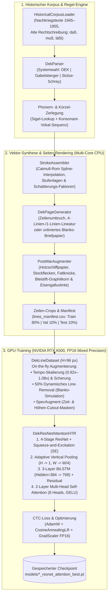

# Historische Kurzschrift-Erkennung (DEK, Gabelsberger & Stolze-Schrey)

Automatisiertes End-to-End-System zur **Synthese**, **Scan-Vorverarbeitung** und **Handschrifterkennung (HTR)** historischer deutscher Kurzschrift-Manuskripte mittels Computer Vision und Deep Learning (`PyTorch`, `CUDA FP16 Mixed Precision`).

Das Projekt unterstützt die drei bedeutendsten deutschen Stenografiesysteme:
1. **DEK – Deutsche Einheitskurzschrift (ab 1924 / Verkehrsschrift):** 4-Linien-System mit Konsonanten-Grundzeichen, symbolischer Vokalverbindung (Weite × Höhe × Druckstärke) und festen Verkehrsschrift-Kürzeln.
2. **Gabelsberger-Kurzschrift (Franz Xaver Gabelsberger, ab 1834):** Fließend-kursive *„Redezeichenkunst"* auf einer 1-Linien-Grundlineatur mit Doppelarkaden, kleinen Grundschlingen, runden Vokalwölbungen und klassischen Gabelsberger-Sigeln.
3. **Stolze-Schrey-Kurzschrift (Vereinigtes System Stolze-Schrey, ab 1897):** Geometrisch-systematische Abstrich-Konsonanten kombiniert mit Aufstrich-Vokalverbindungen (Eng-/Weitstellung, Grund-/Hoch-/Tiefstellung, Schattierung) und System-Sigeln.

---

## 📊 Architektur- & Pipeline-Diagramme

### 1. Trainings-Pipeline (Synthetische Datengenerierung & GPU-Pretraining)



---

### 2. Inferenz-Pipeline (Scan-Vorverarbeitung, TTA & Shallow-Fusion Decoding)

```mermaid
flowchart LR
    subgraph PRE["1. Scan-Vorverarbeitung (src/preprocessing/)"]
        S1["Roher Scan<br/>(TIFF / PNG / JPG)"] --> S2["DocumentDeskewer<br/>(Projektionsvarianz-<br/>Schräglagenkorrektur)"]
        S2 --> S3["DocumentEnhancer<br/>(CLAHE Kontrast &<br/>Ausleuchtung)"]
        S3 --> S4["Adaptive LineSegmenter<br/>(Auflösungsadaptive Gauß-Glättung,<br/>Peak-Tal-Schnitt & Bounding-Boxes)"]
    end

    subgraph TTA["2. Zero-Training TTA & Netzdurchlauf (src/recognition/)"]
        S4 --> T1["Multi-Scale TTA Generator (H=96 px)<br/>• Variante 1: Rohbild (1.00x)<br/>• Variante 2: Perzentil-Normalisiert & Line-Removed (1.00x)<br/>• Variante 3: Gestaucht (0.94x, weitläufige Schrift)<br/>• Variante 4: Gedehnt (1.06x, enge Schrift)"]
        T1 --> T2["DekResNetAttentionHTR<br/>(Batch-Forward-Pass)"]
        T2 --> T3["Zeitliche Logit-Interpolation<br/>& Gewichtetes Ensembling"]
    end

    subgraph DEC["3. Shallow-Fusion Beam-Search & Postprocessing (src/postprocessing/)"]
        T3 --> D1["Logit-Aufbereitung<br/>(Blank-Penalty -0.15 &<br/>Temperatur T=1.15)"]
        D1 --> D2["CTC Prefix Beam-Search (k=10)<br/>mit Live Shallow-Fusion:<br/>• WordTrieNode Präfix-Bonus<br/>• Wort-Bigramm-Sprachmodell P(w_i | w_i-1)"]
        D2 --> D3["HistoricalLexiconCorrector<br/>(Levenshtein Early-Stopping<br/>Nachkorrektur)"]
        D3 --> D4["Fertige Transkription"]
    end
```



---

## 🔬 Detaillierte Technische Features

### 1. Multi-System Kurzschrift-Engine (`src/dek_rules/`)
- **Vektorielles Stufen- & Druckmodell (`symbols.py`):** Jedes Kurzschriftzeichen ist als Sequenz von `StrokeSegment`-Pfaden in relativen Stufeneinheiten (`1 Stufe = 1.0`) definiert, inklusive `is_shaded` und kontinuierlichem `thickness_factor` (`1.0` für Haarstriche bis `2.6` für kräftige Druckverstärkung/Schattierung).
- **Drei vollständige Regelwerke:**
  - `symbols.py` (**DEK**): Konsonanten (`t`, `d`, `w`, `f`, `p`, `b`, `m`, `n`, `l`, `r`, `s`, `sch`, `ch`, `g`, `k`), symbolische Vokalverbindungen (`e`, `i`, `o`, `u`, `a`, `ei`, `au`) und Kürzel.
  - `gabelsberger_symbols.py` (**Gabelsberger 1834**): Steiler `t`-Aufstrich (`1.85` Stufen), Doppelarkaden-`m`, punktförmige `l`-Grundschlinge, Druckvokalisation (`a`), Rundwölbung (`o`) und historische Sigel.
  - `stolze_schrey_symbols.py` (**Stolze-Schrey 1897**): Strenge Abstrich-Konsonanten (`t` zweistufig, `d` einstufig, `r` als Kreisringel, `m`/`k` als Kopfbögen) kombiniert mit Aufstrich-Vokalverbindungen.
- **Phonetischer Parser (`parser.py`):** Führt automatisch Lautersetzungen (`sch`, `ch`, `ck -> k`, `ph -> f`, `qu -> kw`, `tz -> z`) durch, prüft vorrangig auf System-Sigel/Kürzel und zerlegt reguläre Wörter in alternierende Konsonant-Vokal-Graphemketten.

### 2. Synthetischer Manuskript- & Nachkriegs-Generator (`src/generator/`)
- **Catmull-Rom Spline-Assembler (`stroke_model.py`):** Berechnet aus den diskreten Stützpunkten natürliche, zweifach stetig differenzierbare Handschriftkurven mit virtueller Endpunkt-Extrapolation und dynamischer Pinselbreite.
- **Seiten-Generator (`page_generator.py`):** Rendert komplette Manuskriptseiten mit automatischem Zeilenumbruch (`Line Wrapping`), wahlweise mit 4-Linien-DEK-Lineatur, 1-Linien-Gabelsberger-Lineatur oder komplett **ohne Hilfslinien auf reinweißem Briefpapier (`pure_white`)**, und exportiert exakte Zeilen-Bounding-Boxes.
- **Nachkriegs-Alterung (`historical/post_war_augmenter.py`):** Simuliert zeittypische Dokumente (1945–1955) mit Holzschliff-Papiervergilbung (`wood_pulp_brown`, `aged_yellow`, `faded_cream`), radialer Randoxidation, Gaußschen Stockflecken (*Foxing*), horizontalen Brief-Faltknicken sowie Graphit-Bleistiftabrieb und Eisengallustinte.
- **Multi-Core Batch-Pipeline (`historical/batch_pipeline.py`):** Erzeugt über `ProcessPoolExecutor` auf allen CPU-Kernen parallel hunderte Seiten und tausende Zeilen-Crops inklusive automatischem `80/10/10` Train/Val/Test-Split.

### 3. Auflösungsadaptive Scan-Vorverarbeitung (`src/preprocessing/`)
- **Automatische Schräglagenkorrektur (`deskew.py`):** Bestimmt über die Maximierung der Varianz des horizontalen Projektionsprofils den exakten Rotationswinkel (im Bereich `±6.0°`) und richtet schiefe Scans gerade aus.
- **CLAHE-Bildverbesserung (`enhancer.py`):** Kontrastbegrenzte adaptive Histogramm-Egalisierung zur Ausgleichung ungleichmäßiger Scanner-Ausleuchtung und verblasster Bleistiftstriche.
- **Auflösungsadaptiver Zeilensegmentierer (`segmenter.py`):**
  - Skaliert Mindestabstand, Padding und Gauß-Filterbreite (`sigma`) automatisch relativ zur Bildhöhe (`scale_factor = h / 1700.0`).
  - Funktioniert dadurch sowohl auf hochauflösenden Archivscans (`1400×1980 px`) als auch auf kleineren Briefscans (`600×991 px` mit über 20 eng stehenden Zeilen) und trennt selbst einzeilige Datums-, Anrede- und Grußzeilen zuverlässig auf.

### 4. Hybride HTR-Architektur & Training (`src/recognition/`)
- **`DekResNetAttentionHTR` (`model.py`, ~33,5 Mio. Parameter):**
  - **Squeeze-and-Excitation ResNet-Backbone (`stage1`–`stage4`):** Vier Residual-Stufen mit `SiLU`-Aktivierung und `SqueezeExcitation2d`-Kanalgewichtung (reduziert die Breite exakt um Faktor 4 auf `W/4`, während die Höhe über `AdaptiveAvgPool2d((1, None))` flexibel von `H=96 px` auf `1` komprimiert wird).
  - **Lokale Sequenz-Modellierung:** 3-schichtiges bidirektionales LSTM (`hidden_size=384` -> `768` Kanäle) mit Residual-Verbindung und `LayerNorm`.
  - **Globale Kontext-Modellierung:** 2-schichtiger **Transformer Self-Attention Encoder** (`8 Attention Heads`, `dim_feedforward=2048`, `GELU`, `Pre-LayerNorm`) mit `PositionalEncoding1D` zur Auflösung mehrdeutiger Kurzschrift-Kürzel über den gesamten Satzkontext.
- **On-the-fly Trainings-Augmentierung (`dataset.py`):**
  - Dynamische horizontale Schreibtempo-Skalierung (`0.92x–1.08x`) und affine Scherung/Rotation.
  - **50 % On-the-fly Line-Removal:** Unterdrückt während des Trainings bei der Hälfte aller Zeilen schwache Hilfslinien (`bg_cutoff`), sodass dasselbe Modell gleichzeitig für linierte Stenoblöcke und unliniertes weißes Papier trainiert wird.
  - **SpecAugment für Handschrift:** Zufällige vertikale Zeitmasken und horizontale Höhenmasken zwingen das BiLSTM/Attention-Netz dazu, fehlende Strichfragmente aus dem Kontext zu rekonstruieren.
- **GPU-Training (`train.py`):** Optimiert mit `AdamW`, `CosineAnnealingLR`, Gradient Clipping (`max_norm=5.0`), `torch.amp.GradScaler('cuda')` (FP16 Tensor Cores), automatischem **Checkpoint-Resume** und Windows-Standby-Schutz (`ES_CONTINUOUS | ES_SYSTEM_REQUIRED`).

### 5. Zero-Training Inferenz-Boost & Sprachmodell (`src/postprocessing/`)
Ohne erneutes Training steigern vier kombinierte Inferenz-Techniken die Erkennungsrate auf ungesehenen Dokumenten:
1. **Multi-Scale Test-Time Augmentation (`predict.py`):** Jede Zeile wird in 4 Varianten (Rohbild, adaptiv hintergrundbereinigt, `0.94x` gestaucht, `1.06x` gedehnt) durch das Netz geschickt; die Wahrscheinlichkeitsverteilungen werden zeitlich via `F.interpolate` synchronisiert und gewichtet gemittelt.
2. **Adaptive Tinten-Normalisierung (`normalize_ink_tensor`):** Schätzt das Hintergrund-Papierniveau über das 50%-Quantil (Median) und spreizt blasse Bleistiftstriche über das 99,5%-Quantil automatisch auf `[0.0, 1.0]`.
3. **Blank-Penalty & Temperatur-Skalierung (`ctc_decoder.py`):** Senkt übermäßige `<blank>`-Logits um `0.15` ab und glättet die Verteilung mit `T = 1.15`, damit kurze Vokal-Verbindungsstriche nicht verschluckt werden.
4. **Shallow-Fusion CTC Beam-Search + Trie & Bigramm-LM (`ctc_decoder.py`):**
   - Prüft während des Beam-Search (`beam_width=10`) bei jedem Buchstaben in $O(1)$ über einen **Präfix-Trie (`WordTrieNode`)**, ob ein gültiger deutscher Wortanfang vorliegt (`prefix_bonus`).
   - Bewertet an Wortgrenzen (Leerzeichen) den Übergang vom vorherigen zum aktuellen Wort über ein interpoliertes **Wort-Bigramm-/Unigramm-Sprachmodell** (`get_word_transition_score`), gefolgt von einer schnellen Levenshtein-Nachkorrektur (`HistoricalLexiconCorrector`).

---

## 📁 Projektstruktur

```text
Kurzschrift/
├── data/
│   ├── raw_scans/          # Eingescannte Originaldokumente (TIFF / PNG / JPG)
│   ├── processed/          # Entzerrte und segmentierte Zeilenbilder + Debug-Overlays
│   ├── synthetic/          # Synthetisch erzeugte Trainingsdaten (DEK, Gabelsberger, Stolze-Schrey)
│   │   ├── historical_pretraining/   # DEK Nachkriegs-Datensatz & Demo-Seiten
│   │   ├── historical_gabelsberger/  # Gabelsberger Nachkriegs-Datensatz
│   │   └── historical_stolze_schrey/ # Stolze-Schrey Nachkriegs-Datensatz
│   └── annotations/        # Ground-Truth Transkriptionen für echte Scans
├── models/                 # Trainierte PyTorch HTR-Modellgewichte (*.pt)
├── src/
│   ├── dek_rules/          # Regelwerke, Grapheme, Vokalverbindungen & Kürzel/Sigel
│   │   ├── symbols.py                # DEK Grundzeichen, Vokalstufen & Kürzel
│   │   ├── gabelsberger_symbols.py   # Gabelsberger (1834) Grapheme, Vokalisation & Sigel
│   │   ├── stolze_schrey_symbols.py  # Stolze-Schrey (1897) Abstrich-Systematik & Kürzel
│   │   └── parser.py                 # Multi-System Text-zu-Stenogramm Parser
│   ├── generator/          # Synthetische Datengenerierung & Augmentierung
│   │   ├── stroke_model.py           # Catmull-Rom Spline-Interpolation & Linienzusammenbau
│   │   ├── renderer.py               # Pillow- & SVG-Rendering mit variabler Druckstärke
│   │   ├── page_generator.py         # Vollständige Manuskriptseiten (liniert & unliniert/reinweiß)
│   │   ├── dataset.py                # Zeilen-Batch-Generator
│   │   └── historical/               # Nachkriegszeit-Spezialisierung (1945–1955)
│   │       ├── corpus_loader.py      # Historische Texte & Vokabular (alte Rechtschreibung)
│   │       ├── post_war_augmenter.py # Bleistift/Eisengallustinte, Holzschliff, Stockflecken, Falten
│   │       └── batch_pipeline.py     # Parallele High-Throughput Multi-Core Batch-Generierung
│   ├── preprocessing/      # Scan-Vorverarbeitung
│   │   ├── deskew.py                 # Automatische Schräglagenkorrektur (Projektionsvarianz)
│   │   ├── enhancer.py               # CLAHE & Ausleuchtungs-Normalisierung
│   │   ├── segmenter.py              # Auflösungsadaptiver Zeilensegmentierer (Peak-Tal-Analyse)
│   │   └── pipeline.py               # Master-Pipeline für Dokumentenscans
│   ├── recognition/        # HTR-Erkennungs-Engine
│   │   ├── vocabulary.py             # Zeichensatz & CTC-Dekodierung
│   │   ├── dataset.py                # PyTorch Dataset (On-the-fly Augmentierung, SpecAugment & Line-Removal)
│   │   ├── model.py                  # DekResNetAttentionHTR (SE-ResNet + BiLSTM + Transformer) & DekCRNN
│   │   ├── train.py                  # GPU-Training (FP16 Mixed Precision, CosineAnnealingLR, Resume)
│   │   └── predict.py                # Inferenz-Klasse (DekRecognizer) mit Multi-Scale TTA & Beam-Search
│   └── postprocessing/     # Nachbearbeitung & Sprachmodell
│       └── ctc_decoder.py            # Shallow-Fusion CTC Beam-Search (Trie + Bigramm-LM + Lexikon)
├── tests/
│   ├── test_generator.py             # Generator-Tests für DEK, Gabelsberger & Stolze-Schrey
│   ├── test_recognition.py           # Modell-, TTA-, Beam-Search- & Sprachmodell-Tests
│   └── test_preprocessing.py         # Deskew- & Segmentierungs-Tests
├── run_pretraining.py                # Master-Skript für Datengenerierung & GPU-Training aller Systeme
├── process_scan.py                   # CLI zur Vorverarbeitung & Transkription echter Scans
├── generate_historical_sample.py     # Erzeugt historische Beispielseiten für alle 3 Systeme
├── generate_samples.py               # Einzelzeichen- & Zeilen-Demo
├── generate_test_page.py             # Ganze DIN A5 Manuskriptseite
└── requirements.txt
```

---

## 🚀 Schnelleinstieg & Befehle

### 1. Historische Beispielseiten für alle 3 Kurzschriftsysteme erzeugen
```bash
python generate_historical_sample.py
```
Erzeugt im Ordner `data/synthetic/historical_pretraining/demo/`:
- `bonn_1948_bleistift.png` (**DEK**)
- `bonn_1948_gabelsberger.png` (**Gabelsberger**)
- `bonn_1948_stolze_schrey.png` (**Stolze-Schrey**)

### 2. Großes Pretraining starten oder fortsetzen (mit Checkpoint-Resume)
```bash
# Alle drei Systeme (DEK, Gabelsberger, Stolze-Schrey) mit ResNet-Attention (H=96) trainieren:
python run_pretraining.py --system all --arch resnet_attention --height 96 --pages 500 --epochs 12

# Gezielt ein einzelnes System weitertrainieren (setzt nahtlos an der letzten gespeicherten Epoche fort):
python run_pretraining.py --system dek --arch resnet_attention --height 96 --epochs 20
```

### 3. Echte Scans vorverarbeiten, segmentieren und transkribieren
```bash
python process_scan.py pfad/zum/scan.jpg --output-dir data/processed/mein_scan --model models/stolze_schrey_resnet_attention_best.pt
```

### 4. Einzelne Zeilen per Python-API transkribieren (inkl. TTA & Shallow-Fusion)
```python
from src.recognition.predict import DekRecognizer

recognizer = DekRecognizer(
    model_path="models/dek_resnet_attention_best.pt",
    use_beam_search=True,
    use_lexicon=True,
    use_tta=True,  # Multi-Scale Test-Time Augmentation
)
text = recognizer.recognize_line("data/processed/lines/zeile_001.png")
print("Transkription:", text)
```

---

## 🧪 Automatisierte Tests

```bash
python -m unittest discover -s tests -v
```
